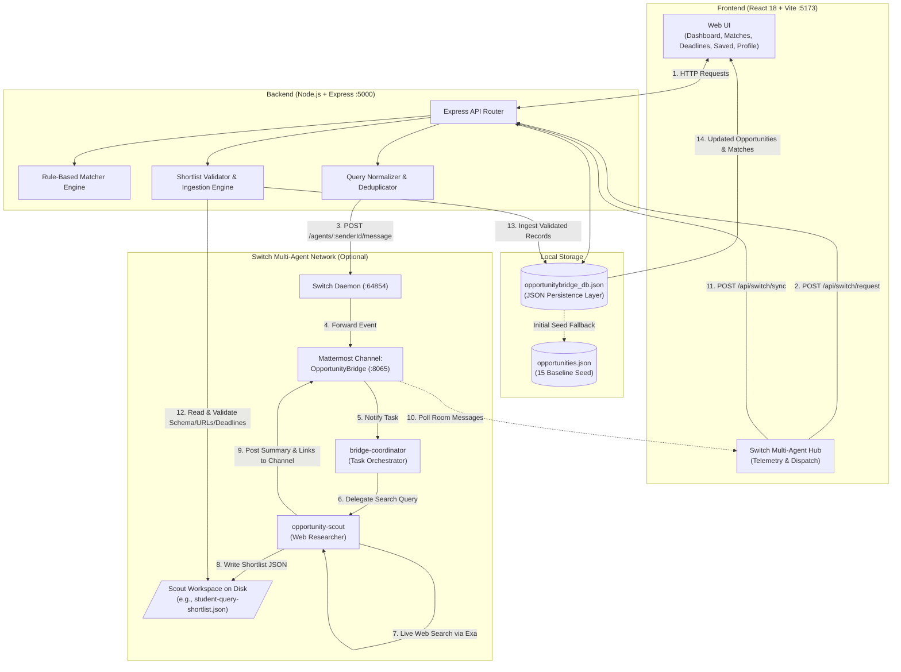
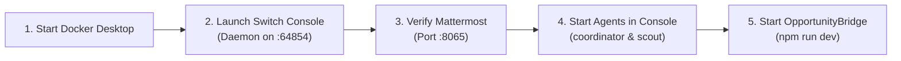

# OpportunityBridge – Your AI-Powered Student Opportunity Assistant 🎓

> **Discover opportunities. Check your eligibility. Never miss a deadline.**  
> Built for the **Flip the Switch Hackathon 2026** (Submission Deadline: November 7, 2026, 11:59 PM IST)

---

## Table of Contents

- [Overview & Problem Statement](#overview--problem-statement)
- [Tech Stack](#tech-stack)
- [System Architecture & Data Lifecycle](#system-architecture--data-lifecycle)
- [Operating Modes](#operating-modes)
  - [Mode 1: Basic Mode (Standalone — No External Service Dependencies)](#mode-1-basic-mode-standalone--no-external-service-dependencies)
  - [Mode 2: Full Switch Mode (Multi-Agent Swarm)](#mode-2-full-switch-mode-multi-agent-swarm)
- [Why Switch is Central & Agent Roles](#why-switch-is-central--agent-roles)
- [Full Switch Mode Setup Guide](#full-switch-mode-setup-guide)
  - [1. Prerequisites](#1-prerequisites)
  - [2. Startup Order & Process Flow](#2-startup-order--process-flow)
  - [3. Environment Configuration](#3-environment-configuration)
  - [4. Agent Configuration & Workspace Paths](#4-agent-configuration--workspace-paths)
  - [5. Mattermost Channel Setup & Teammate Interaction](#5-mattermost-channel-setup--teammate-interaction)
- [JSON Persistence Layer & Data Integrity](#json-persistence-layer--data-integrity)
- [Project Structure](#project-structure)
- [Quick Start: Local Installation & Run](#quick-start-local-installation--run)
- [Local URLs & API Reference](#local-urls--api-reference)
- [Automated Testing & Coverage](#automated-testing--coverage)
- [Screenshots & Demo Video](#screenshots--demo-video)
- [Security & Credential Guidelines](#security--credential-guidelines)
- [Hackathon Requirement Alignment](#hackathon-requirement-alignment)

---

## Overview & Problem Statement

College students frequently struggle to discover relevant, high-quality academic opportunities—such as internships, scholarships, hackathons, fellowships, and research programs—due to fragmented portals, expired deadlines, and opaque eligibility criteria.

**OpportunityBridge** solves this problem by providing a student-centric platform combining:

1. **Curated Opportunity Discovery:** Explore vetted academic and career opportunities categorized by internships, scholarships, hackathons, and competitions.
2. **Transparent Eligibility & Skill Matching:** A deterministic, rule-based matching engine that evaluates student discipline, year of study, skills, and interests without opaque black-box AI scoring.
3. **Deadline Categorization:** A structured timeline organizing deadlines into *Urgent* (≤ 7 days), *Upcoming* (8–30 days), and *Rolling* categories.
4. **Application Guidance & Checklist Persistence:** Interactive preparation checklists (Resume, SOP, Portfolio, Transcripts) persisted per opportunity.
5. **Switch Multi-Agent Scouting Pipeline:** An autonomous agent swarm operating over Mattermost that discovers, validates, and synchronizes fresh opportunities on demand.

---

## Tech Stack

| Layer | Technologies | Purpose |
| :--- | :--- | :--- |
| **Frontend UI** | React 18, Vite, Tailwind CSS, Lucide React | Responsive single-page application with dashboard, filters, and modals. |
| **Backend API** | Node.js (v18+), Express.js (v4), CORS, Dotenv | RESTful API server handling matching, persistence, and agent coordination. |
| **Persistence Layer** | Lightweight JSON-file-backed persistent store | Schema-structured local store (`opportunitybridge_db.json`) and seed (`opportunities.json`). |
| **Multi-Agent Swarm** | Switch Platform (Daemon on `:64854`), OpenCode | Autonomous agent orchestration and runtime environment. |
| **Team Collaboration** | Mattermost (port `:8065`), Channel: `OpportunityBridge` | Real-time agent collaboration, webhook relays, and human-in-the-loop interaction. |
| **Live Web Discovery** | Exa Search API via `opportunity-scout` | Real-time web search, link extraction, and academic criteria validation. |
| **Automated Testing** | Node.js Native Test Runner (`node --test`), `node:assert` | 27 automated unit tests covering scoring, normalization, and deduplication. |

---

## System Architecture & Data Lifecycle

The following diagram illustrates the complete workflow: from student search request to agent web research, shortlist generation on disk, backend validation, database persistence, and UI display:



---

## Operating Modes

OpportunityBridge is engineered to be **modular and resilient**, supporting two operating modes:

### Mode 1: Basic Mode (Standalone — No External Service Dependencies)

> **Quick Evaluation for Judges:** Basic Mode requires **no Docker, no Switch Daemon, and no Mattermost**. The application runs immediately with standard npm packages.

- Operates using the local JSON-file-backed persistence layer (`opportunitybridge_db.json`) and the 15 baseline curated opportunities (`opportunities.json`).
- Full access to student profile management, opportunity filtering, rule-based match scoring with breakdowns, deadline tracking, and interactive application checklists.
- The UI status indicator will show `Offline` for Switch, but all web application features operate smoothly with zero runtime errors.

### Mode 2: Full Switch Mode (Multi-Agent Swarm)

- Connects the backend to the local Switch server (`SWITCH_SERVER_URL=http://127.0.0.1:64854`) and Mattermost room (`OpportunityBridge`).
- Students dispatch fresh queries from the UI (e.g., *"Cybersecurity internships for second-year CSE students"*).
- The query passes through backend normalization and deduplication to avoid redundant agent dispatches.
- Autonomous OpenCode agents collaborate in Mattermost to research programs, verify official links/deadlines, exclude ineligible entries, and write structured shortlist JSON files.
- Scouted shortlist files are validated and imported into the local database with duplicate prevention.

---

## Why Switch is Central & Agent Roles

### Why Switch is Essential to OpportunityBridge
Static opportunity directories degrade rapidly: deadlines expire, application links change, and new programs launch continuously. Traditional hardcoded web scrapers break when web layouts shift and lack domain context.

Switch transforms OpportunityBridge into an **autonomous, event-driven opportunity discovery network**. Instead of relying on manual data entry, students can dispatch natural-language discovery requests. Autonomous AI agents collaborate inside a dedicated Mattermost channel, conduct live web research, filter results against academic eligibility, and deliver machine-readable shortlists directly to the application.

### Specialized Agent Swarm Roles

| Agent Name | Agent ID | Core Role & Responsibilities |
| :--- | :--- | :--- |
| **`bridge-coordinator`** | `85bba940-1799-4c1c-8a41-ac7b8e4138ca` | **Task Orchestrator:** Monitors the Mattermost room for student queries, checks historical requests for duplicates, defines task parameters, delegates search scopes to `opportunity-scout`, and reports progress back to teammates. |
| **`opportunity-scout`** | `814eb770-74f0-4c57-80f7-92ef3ce4bc9e` | **Autonomous Web Researcher:** Queries the live web using the Exa search API, filters results against target academic criteria (branch, year, GPA), extracts application deadlines, validates official URLs, and outputs structured shortlist JSON deliverables to disk. |
| **`switch-buddy-admin`** | `3cdb41ce-bdc4-4332-94c7-31ba4da44ba9` | **Gateway & Webhook Relay:** Bridges communication between the Express API server and the Mattermost room, handling message delivery and room history retrieval. |

---

## Full Switch Mode Setup Guide

Follow this guide to run OpportunityBridge with the complete multi-agent Switch and Mattermost stack.

### 1. Prerequisites

- **Docker Desktop:** Running and healthy (used by Switch Console to host the Mattermost container).
- **Switch Console Desktop App:** Installed (provides local agent management and daemon).
- **Node.js:** v18.11.0 or higher.

### 2. Startup Order & Process Flow

To bring up the multi-agent environment reliably:



1. **Start Docker Desktop:** Ensure the Docker daemon is active.
2. **Launch Switch Console:** Start the Switch desktop application. It automatically exposes the Switch daemon on port `64854`.
3. **Verify Mattermost:** Confirm Mattermost is accessible at `http://localhost:8065` with the `OpportunityBridge` channel created.
4. **Start Agents:** Verify `bridge-coordinator`, `opportunity-scout`, and `switch-buddy-admin` are active and bound to the room.
5. **Configure & Start OpportunityBridge:** Copy the environment template and run `npm run dev`.

### 3. Environment Configuration

Copy the template file to create your local `.env`:

```bash
cp server/.env.example server/.env
```

Configure `server/.env` with your local settings:

```env
PORT=5000
NODE_ENV=development
DATA_DIR=./data
CLIENT_ORIGIN=http://localhost:5173

# Switch Multi-Agent Configuration
SWITCH_SERVER_URL=http://127.0.0.1:64854
SWITCH_ROOM_ID=b721b78a-33b7-4629-9c08-1ddc1def71c6
SWITCH_SENDER_AGENT_ID=3cdb41ce-bdc4-4332-94c7-31ba4da44ba9
SWITCH_COORDINATOR_ID=85bba940-1799-4c1c-8a41-ac7b8e4138ca
SWITCH_SCOUT_ID=814eb770-74f0-4c57-80f7-92ef3ce4bc9e
SWITCH_API_TOKEN=your_secure_switch_agent_token_here

# Path to opportunity-scout workspace directory (where shortlist JSON files are saved)
# Examples:
#   Windows:      C:\Users\<username>\.switch\agents\<instance-id>\opportunity-scout
#   Linux/macOS:  ~/.switch/agents/<instance-id>/opportunity-scout
SWITCH_SCOUT_DIR=/path/to/switch/agents/opportunity-scout
```

> **Security Note:** `server/.env` is strictly excluded by `.gitignore`. Real credentials and tokens must never be committed to Git.

### 4. Agent Configuration & Workspace Paths

When `opportunity-scout` generates new opportunities, it writes structured JSON shortlist files to its local workspace directory.

To point OpportunityBridge to your local scout directory:
- **macOS / Linux:** Set `SWITCH_SCOUT_DIR` to `~/.switch/agents/<instance-id>/opportunity-scout`
- **Windows:** Set `SWITCH_SCOUT_DIR` to `%USERPROFILE%\.switch\agents\<instance-id>\opportunity-scout`
- *Fallback Mechanism:* If `SWITCH_SCOUT_DIR` is not set or the file is not found there, the backend automatically falls back to checking `server/data/` for shortlist files.

### 5. Mattermost Channel Setup & Teammate Interaction

- **Channel Name:** `OpportunityBridge` (Default Room ID: `b721b78a-33b7-4629-9c08-1ddc1def71c6`).
- **Human-in-the-Loop Interaction:** Teammates and mentors can interact directly with the agent swarm in Mattermost:
  - **Trigger Research:** Post `@bridge-coordinator find robotics competitions for mechanical engineering students`.
  - **Check Status:** Post `@bridge-coordinator status` to inspect current agent deliverables.
  - **Review Findings:** Inspect real-time reasoning and shortlist summaries posted by `opportunity-scout`.

---

## JSON Persistence Layer & Data Integrity

OpportunityBridge uses a lightweight, schema-structured JSON-file-backed persistence engine located at `server/data/opportunitybridge_db.json`, implemented via `LocalDatabase` in [`server/src/config/database.js`](server/src/config/database.js).

### Data Collections

- **`profiles`:** Stores student academic data (name, degree, branch, year of study, skills, interests, location). Persists across server restarts.
- **`opportunities`:** Stores all active opportunity records. Seeded initially with the 15 baseline entries from [`server/data/opportunities.json`](server/data/opportunities.json) and expanded when scout shortlists are synchronized.
- **`saved_applications`:** Stores bookmarked opportunities, notes, and preparation checklist progress (`resume`, `sop`, `portfolio`, `transcripts`).
- **`switch_sync_logs`:** Audit trail of all agent dispatch and shortlist synchronization events.
- **`dispatched_requests`:** Historical index of dispatched queries used for intelligent deduplication.

### Data Integrity Guardrails

- **Baseline Seed Preservation:** The 15 baseline curated opportunities in `opportunities.json` are read-only and immutable; automated agent workflows never delete or overwrite them.
- **Duplicate Prevention on Import:** When synchronizing shortlist files, opportunities are deduplicated by `id` and `title + organization`. Existing records and bookmarks are preserved.
- **Schema & Link Validation:** Imported opportunities must provide valid `http://` or `https://` URLs, non-empty titles, valid organization names, and confirmed deadlines or explicit `rolling` status. Incomplete records are rejected.

---

## Project Structure

```text
OpportunityBridge/
├── package.json              # Monorepo root scripts (dev, install:all, etc.)
├── package-lock.json         # Dependency lockfile
├── README.md                 # Project documentation & setup instructions
├── .gitignore                # Git exclusion rules (.env, .data, local DB, build outputs)
├── client/                   # Frontend React 18 application
│   ├── index.html            # Vite HTML entry point
│   ├── package.json          # Client dependencies (React 18, Vite, Tailwind CSS, Lucide)
│   ├── package-lock.json     # Client lockfile
│   ├── postcss.config.js     # PostCSS configuration
│   ├── tailwind.config.js    # Tailwind CSS design system configuration
│   ├── vite.config.js        # Vite configuration (port 5173, /api proxy to :5000)
│   └── src/                  # Client source code
│       ├── main.jsx          # React DOM root render
│       ├── App.jsx           # Main layout, tab navigation & state shell
│       ├── index.css         # Global Tailwind styles
│       ├── components/       # Reusable UI components
│       │   ├── Navbar.jsx              # Header with system status indicators
│       │   ├── FilterBar.jsx           # Search & category filters
│       │   ├── OpportunityCard.jsx     # Opportunity card with match score & tags
│       │   ├── OpportunityModal.jsx    # Detail view with interactive preparation checklist
│       │   ├── StatCard.jsx            # Metric summary cards for Dashboard
│       │   └── SwitchStatusModal.jsx   # Switch multi-agent telemetry & sync modal
│       ├── pages/            # Primary application views
│       │   ├── DashboardPage.jsx       # Overview metrics, top matches & urgent deadlines
│       │   ├── DiscoveryPage.jsx       # Search & browse all opportunities
│       │   ├── MatchesPage.jsx         # Ranked opportunities with match score breakdowns
│       │   ├── DeadlinesPage.jsx       # Timeline view (urgent, upcoming, rolling)
│       │   ├── SavedApplicationsPage.jsx # Bookmarked items with application checklist
│       │   └── ProfilePage.jsx         # Academic year, degree, branch, skills & interests
│       └── services/
│           └── api.js        # Centralized HTTP client for backend endpoints
└── server/                   # Backend Express.js REST API
    ├── package.json          # Server dependencies (Express, CORS, Dotenv)
    ├── package-lock.json     # Server lockfile
    ├── .env.example          # Environment template (tracked in Git)
    ├── .env                  # Local environment file (created locally, ignored by Git)
    ├── data/                 # Seed data and persistent storage
    │   ├── opportunities.json          # 15 baseline seed opportunities (immutable)
    │   ├── profile.json                # Default student profile template
    │   ├── README.md                   # Data folder notes
    │   └── opportunitybridge_db.json   # Persistent JSON database (created at runtime, ignored by Git)
    ├── src/                  # Server source code
    │   ├── index.js          # Express app entry point & route definitions
    │   ├── config/
    │   │   └── database.js   # LocalDatabase JSON persistence engine
    │   ├── services/
    │   │   ├── dataLoader.js    # Seed dataset loader and profile initializer
    │   │   ├── matcher.js       # Rule-based eligibility & weighted skill-matching engine
    │   │   └── switchService.js # Switch agent dispatch, query deduplication & shortlist sync
    │   └── utils/
    │       └── deadlines.js  # Deadline calculator & categorization utility
    └── tests/                # Automated test suites
        ├── deduplication.test.js # Query normalization & deduplication tests
        └── matcher.test.js       # Matcher scoring, tag mapping & eligibility tests
```

---

## Quick Start: Local Installation & Run

Get OpportunityBridge running locally in **Basic Mode** in two minutes:

### 1. Prerequisites

- **Node.js:** `v18.11.0` or higher (`Node 20+` or `Node 22+` recommended)
- **npm:** `v9.0.0` or higher
- **Git**

```bash
node -v
npm -v
git --version
```

### 2. Clone & Install Dependencies

```bash
git clone https://github.com/pihush09/OpportunityBridge.git
cd OpportunityBridge
npm run install:all
```

*(This runs `npm install` across the root, `server/`, and `client/` directories).*

### 3. Start the Application

```bash
npm run dev
```

*This concurrently starts:*
- **Backend API Server:** Listening on `http://localhost:5000`
- **Frontend Vite Client:** Listening on `http://localhost:5173`

Open [http://localhost:5173/](http://localhost:5173/) in your browser.

---

## Local URLs & API Reference

| Service / Endpoint | Method | Local URL | Description | Verified Status |
| :--- | :--- | :--- | :--- | :--- |
| **Frontend Web App** | `GET` | [http://localhost:5173/](http://localhost:5173/) | OpportunityBridge User Interface | Active (Vite build verified) |
| **API Health Check** | `GET` | [http://localhost:5000/api/health](http://localhost:5000/api/health) | Returns server health status | Active (HTTP 200) |
| **System Status** | `GET` | [http://localhost:5000/api/status](http://localhost:5000/api/status) | Database record counts & agent readiness | Active (HTTP 200) |
| **Dashboard Stats** | `GET` | [http://localhost:5000/api/stats](http://localhost:5000/api/stats) | Aggregated metrics for dashboard | Active (HTTP 200) |
| **Opportunities API** | `GET` | [http://localhost:5000/api/opportunities](http://localhost:5000/api/opportunities) | Filter by category, location, query | Active (HTTP 200) |
| **Opportunity Detail** | `GET` | [http://localhost:5000/api/opportunities/:id](http://localhost:5000/api/opportunities/:id) | Single opportunity with deadline & match info | Active (HTTP 200) |
| **Skill Matches API** | `GET` | [http://localhost:5000/api/matches](http://localhost:5000/api/matches) | Opportunities ranked by match score | Active (HTTP 200) |
| **Deadlines API** | `GET` | [http://localhost:5000/api/deadlines](http://localhost:5000/api/deadlines) | Categorized deadlines (urgent, upcoming, rolling) | Active (HTTP 200) |
| **Saved Applications** | `GET` | [http://localhost:5000/api/saved](http://localhost:5000/api/saved) | Bookmarks & checklist progress | Active (HTTP 200) |
| **Save / Bookmark** | `POST` | [http://localhost:5000/api/saved/:id](http://localhost:5000/api/saved/:id) | Save opportunity and update checklist status | Active (HTTP 200) |
| **Remove Bookmark** | `DELETE` | [http://localhost:5000/api/saved/:id](http://localhost:5000/api/saved/:id) | Remove opportunity from saved bookmarks | Active (HTTP 200) |
| **Student Profile API** | `GET/PUT` | [http://localhost:5000/api/profile](http://localhost:5000/api/profile) | Get or update student profile | Active (HTTP 200) |
| **Switch Request API** | `POST` | [http://localhost:5000/api/switch/request](http://localhost:5000/api/switch/request) | Dispatch search query with deduplication | Active (HTTP 200) |
| **Switch Sync API** | `POST` | [http://localhost:5000/api/switch/sync](http://localhost:5000/api/switch/sync) | Ingest scout shortlist JSON into database | Active (HTTP 200) |
| **Available Shortlists** | `GET` | [http://localhost:5000/api/switch/available-shortlists](http://localhost:5000/api/switch/available-shortlists) | List scout shortlist files in workspace | Active (HTTP 200) |
| **Switch Sync Logs** | `GET` | [http://localhost:5000/api/switch/logs](http://localhost:5000/api/switch/logs) | Audit trail of sync and dispatch events | Active (HTTP 200) |
| **Switch Room History** | `GET` | [http://localhost:5000/api/switch/history](http://localhost:5000/api/switch/history) | Fetch Mattermost room conversation events | Active (HTTP 200) |

---

## Automated Testing & Coverage

The backend test suite runs natively with Node.js's built-in test runner (`node --test`), requiring zero external testing frameworks.

To execute the test suite:

```bash
npm test --prefix server
```

### Verified Test Output

```text
> opportunitybridge-server@1.0.0 test
> node --test tests/*.test.js

--- Running Deduplication & Workflow Unit Tests ---
Test 1: Query normalization handles casing, hyphens, and punctuation
✓ Test 1 passed
Test 2: Known covered query for Piyush is detected as duplicate
✓ Test 2 passed
Test 3: Genuinely new search query triggers fresh run
✓ Test 3 passed
Test 4: Cloud computing & DevOps is recognized as genuinely new
✓ Test 4 passed
--- All Deduplication Unit Tests Passed! ---
✔ tests/deduplication.test.js (320ms)
▶ Skill Normalization & Prevention of False Collisions (3 tests)
▶ 16 Required Student Skills Tag Coverage (16 tests)
▶ Score Responsiveness to Relevant Skills vs Unrelated Skills (5 tests)
▶ Scoring Weights and Eligibility Rules Invariance (2 tests)
ℹ tests 27
ℹ suites 4
ℹ pass 27
ℹ fail 0
```

- **Verified Results:** Exactly **27 passed unit tests across 4 test suites (0 failures)**.
- **Covered Scenarios:**
  - Technical skill normalization across 16 core categories (JavaScript, React, Git, HTML, CSS, Python, C++, Java, web development, frontend, backend, AI, machine learning, CAD, robotics, embedded systems).
  - Substring collision guardrails (e.g., distinguishing `AI` or `CAD` without matching unrelated words).
  - Score responsiveness: relevant skills increase match score, while unrelated skills yield zero delta.
  - Academic eligibility boundaries: ineligible years or branches receive zero match.
  - Safe query deduplication: whitespace, hyphen, and case variations are detected to prevent redundant agent runs.

---

## Screenshots 

### Application Previews
- **Dashboard & Metric Overview:**
   
    

- **Opportunity Discovery & Category Filters:**
  
    

- **Switch Multi-Agent Telemetry Hub:**
  
    
    
    

  - **Switch Console Mattermost Chatroom:**
   
    

---

## Security & Credential Guidelines

To ensure repository security and compliance with hackathon submission guidelines:

1. **No Committed Secrets:** Real API keys, Switch tokens, and private credentials must remain strictly in local `.env` files and must **never** be committed to Git.
2. **Ignored Directories:** The root [`.gitignore`](.gitignore) explicitly excludes:
   - `server/.env` and any `.env.*` files (only [`server/.env.example`](server/.env.example) with placeholder text is tracked).
   - `.data/` (OpenCode agent databases and runtime logs).
   - `server/data/opportunitybridge_db.json` (local persistent JSON store).
   - `.switch/` (local Switch daemon state and agent workspaces).
   - Build outputs (`client/dist/`, `build/`) and temporary log files.
3. **Template Configuration:** Always share configuration templates using `server/.env.example` with non-sensitive placeholder values.

---

## Hackathon Requirement Alignment

| Hackathon Requirement | OpportunityBridge Implementation | Documentation Reference |
| :--- | :--- | :--- |
| **1. Agents Connected** | Connected to 3 autonomous Switch agents: `bridge-coordinator` (task orchestrator), `opportunity-scout` (live web researcher), and `switch-buddy-admin` (gateway). | [Why Switch is Central & Agent Roles](#why-switch-is-central--agent-roles) |
| **2. Channel Setup** | Mattermost room `OpportunityBridge` (`b721b78a-33b7-4629-9c08-1ddc1def71c6`) with multi-agent orchestration and human teammate collaboration. | [Mattermost Channel Setup](#5-mattermost-channel-setup--teammate-interaction) |
| **3. How to Run** | Clear, unambiguous instructions provided for both **Basic Mode** (standalone, no external services) and **Full Switch Mode** (Docker + Switch + Mattermost). | [Quick Start](#quick-start-local-installation--run) & [Full Switch Mode Setup Guide](#full-switch-mode-setup-guide) |
| **4. Reproducible Codebase** | Production build verified cleanly with Vite; 27/27 automated unit tests passing with zero failures. | [Automated Testing & Coverage](#automated-testing--coverage) |

---

*OpportunityBridge – Bridging students with verified opportunities.*  
*Flip the Switch Hackathon 2026*
