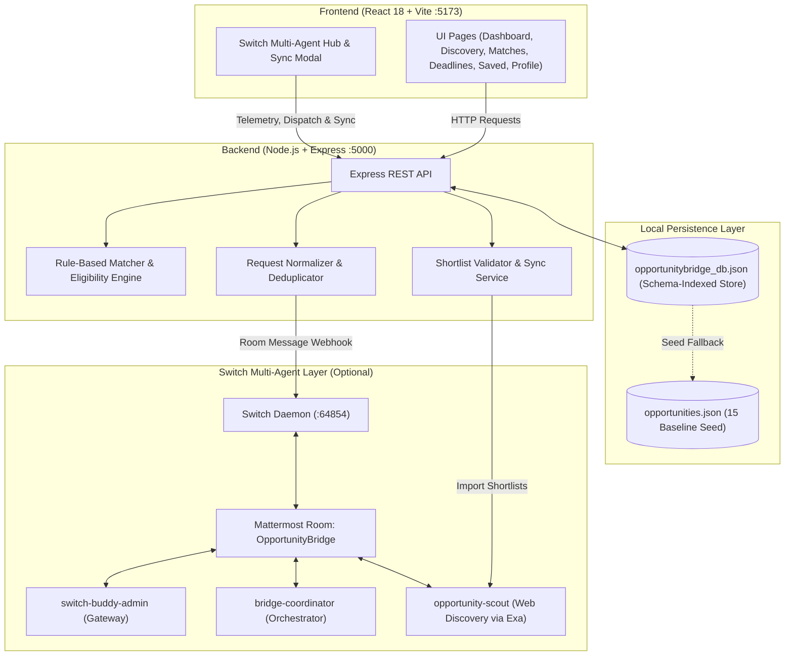

# OpportunityBridge – Your AI-Powered Student Opportunity Assistant 🎓

> **Discover opportunities. Check your eligibility. Never miss a deadline.**  
> Built for the **Flip the Switch Hackathon 2026** (Submission Deadline: November 7, 2026, 11:59 PM IST)

---

## Table of Contents

- [Overview & Problem Statement](#overview--problem-statement)
- [System Architecture](#system-architecture)
- [Operating Modes: Basic Mode vs. Full Switch Mode](#operating-modes-basic-mode-vs-full-switch-mode)
- [Switch Multi-Agent Workflow](#switch-multi-agent-workflow)
- [Database Persistence & Data Integrity](#database-persistence--data-integrity)
- [Project Structure](#project-structure)
- [Prerequisites](#prerequisites)
- [Local Setup & Installation](#local-setup--installation)
- [Running the Application](#running-the-application)
- [Local URLs & API Reference](#local-urls--api-reference)
- [Automated Testing](#automated-testing)
- [Security & Credential Guidelines](#security--credential-guidelines)
- [Implementation & Verification Status](#implementation--verification-status)

---

## Overview & Problem Statement

College students frequently struggle to discover relevant, verified academic opportunities—such as internships, scholarships, hackathons, fellowships, and competitions—due to fragmented portals, expired deadlines, and complex eligibility criteria.

**OpportunityBridge** solves this problem by providing a student-first web application that combines:

1. **Curated Opportunity Discovery:** Explore high-quality opportunities across internships, scholarships, hackathons, and competitions.
2. **Transparent Eligibility & Skill Matching:** A rule-based engine that evaluates academic discipline, year of study, skills, and interests without opaque black-box AI decisions.
3. **Deadline Tracking:** Visual timeline grouping opportunities into *Urgent* (≤ 7 days), *Upcoming* (8–30 days), and *Rolling* deadlines.
4. **Application Guidance & Checklist Persistence:** Interactive, step-by-step preparation checklists (Resume, SOP, Portfolio, Transcripts) persisted per opportunity.
5. **Switch Multi-Agent Coordination (Optional):** An agentic scouting pipeline connecting `bridge-coordinator` and `opportunity-scout` over Mattermost to discover, verify, and synchronize fresh opportunities from the web.

---

## System Architecture



---

## Operating Modes: Basic Mode vs. Full Switch Mode

OpportunityBridge is engineered to be **resilient and modular**, supporting two distinct operating modes:

### 1. Basic Mode (Standalone — Zero External Dependencies)

> **Does it work without Switch, Mattermost, and Docker?**  
> **YES, 100%.** Basic mode runs completely locally with standard Node.js. It requires **no Docker containers**, **no Switch daemon**, and **no Mattermost instance**.

In Basic Mode:
- The entire web application functions out-of-the-box using the local file-backed database (`opportunitybridge_db.json`) and the 15 verified baseline opportunities (`opportunities.json`).
- Students can browse, filter, search, view match scores with explanations, update their profile, track deadlines, save opportunities, and persist application checklist progress.
- API health and status checks report `ready` without requiring external connections.

### 2. Full Switch Mode (Autonomous Multi-Agent Swarm)

When the local Switch daemon (`http://127.0.0.1:64854`) and Mattermost room (`OpportunityBridge`) are running:
- The frontend **Switch Multi-Agent Hub** modal connects directly to the agent network.
- Students can dispatch natural-language discovery queries (e.g., *"Cybersecurity internships for second-year CSE students"*).
- The query passes through backend normalization and deduplication to prevent redundant room spam.
- Autonomous OpenCode agents collaborate in Mattermost to research, verify, and write dedicated shortlist files.
- Verified shortlists can be reviewed in the UI and synchronized into the local database with duplicate prevention.

---

## Switch Multi-Agent Workflow

OpportunityBridge coordinates with three dedicated agents in the Switch workspace:

| Agent Name | Agent ID | Role & Responsibilities |
| :--- | :--- | :--- |
| **`bridge-coordinator`** | `85bba940-1799-4c1c-8a41-ac7b8e4138ca` | **Orchestrator**: Holds the MVP task plan (`PLAN.md`), receives website search requests, checks if queries are already covered by existing files, isolates fresh requests into bounded deliverables (e.g. `piyush-cybersecurity-and-network-shortlist.json`), delegates tasks to the scout, and confirms delivery in the room. |
| **`opportunity-scout`** | `814eb770-74f0-4c57-80f7-92ef3ce4bc9e` | **Research & Verification Specialist**: Executes live web searches (via Exa), inspects official application pages, checks academic eligibility rules (year, branch, citizenship), verifies deadlines, excludes unverifiable listings, and generates isolated shortlist JSON files while keeping the baseline `opportunities.json` untouched. |
| **`switch-buddy-admin`** | `3cdb41ce-bdc4-4332-94c7-31ba4da44ba9` | **Integration Gateway**: The webhook sender agent used by OpportunityBridge's Express backend (`SWITCH_SENDER_AGENT_ID`) to post requests into the Mattermost room and query room history. |

### Intelligent Request Deduplication

To prevent agent swarms from repeating identical expensive search runs:
1. **Query Normalization:** Trailing whitespace, casing, hyphens, and punctuation are normalized (e.g., `"second-year"` and `"second year"` map identically).
2. **Coverage Checks:** The backend checks if a student's request is already covered by existing deliverables (such as `piyush-all-shortlist.json`) or a recent dispatch.
3. **Safe Deduplication:** Repeated requests return an informative `deduplicated: true` response without sending redundant spam to the Mattermost room.

---

## Database Persistence & Data Integrity

OpportunityBridge uses a schema-indexed, file-backed relational database located at [`server/data/opportunitybridge_db.json`](file:///server/data/opportunitybridge_db.json), implemented via `LocalDatabase` in [`server/src/config/database.js`](file:///server/src/config/database.js).

### Data Tables

- **`profiles`:** Stores the student's profile (name, degree, branch, year of study, skills, interests, location). Survives server restarts.
- **`opportunities`:** Stores all active opportunity records. Seeded initially with 15 verified entries from [`server/data/opportunities.json`](file:///server/data/opportunities.json) and dynamically expanded via shortlist synchronization.
- **`saved_applications`:** Stores bookmarked opportunities, notes, application status, and per-item checklist progress (`resume`, `sop`, `portfolio`, `transcripts`).
- **`switch_sync_logs`:** Audit log of all agent dispatches and shortlist synchronizations.
- **`dispatched_requests`:** Historical index of dispatched queries used for deduplication.

### Data Integrity Rules

- **Baseline Seed Invariance:** The 15 baseline curated opportunities in `opportunities.json` are **immutable** and never modified or deleted.
- **Duplicate Prevention on Import:** When syncing a scout shortlist, opportunities are deduplicated by `id` and `title + organization`. Existing records and bookmarks are preserved.
- **URL & Deadline Validation:** Imports strictly require valid `http://` or `https://` URLs (rejecting placeholder or invalid links) and confirmed dates or explicit `rolling` status.

---

## Project Structure

```text
OpportunityBridge/
├── package.json              # Root package with multi-package scripts & concurrently
├── package-lock.json         # Root dependency lockfile
├── README.md                 # Project documentation & setup instructions
├── .gitignore                # Git exclusions (.env, .data, local DB, build outputs)
├── client/                   # Frontend React 18 application
│   ├── index.html            # Vite HTML entry point
│   ├── package.json          # Client dependencies (React 18, Vite, Tailwind CSS, Lucide)
│   ├── package-lock.json     # Client lockfile
│   ├── postcss.config.js     # PostCSS configuration
│   ├── tailwind.config.js    # Tailwind CSS design system configuration
│   ├── vite.config.js        # Vite configuration (port 5173, /api proxy to :5000)
│   └── src/                  # Client source code
│       ├── main.jsx          # React DOM root render
│       ├── App.jsx           # Main layout, tab router & application shell
│       ├── index.css         # Global Tailwind styles
│       ├── components/       # UI Components
│       │   ├── Navbar.jsx              # Navigation header with system status indicators
│       │   ├── FilterBar.jsx           # Search and category filtering controls
│       │   ├── OpportunityCard.jsx     # Opportunity card with match score and tags
│       │   ├── OpportunityModal.jsx    # Detail view with interactive checklist & guidance
│       │   ├── StatCard.jsx            # Metric summary cards for Dashboard
│       │   └── SwitchStatusModal.jsx   # Switch multi-agent telemetry & sync modal
│       ├── pages/            # Core Views
│       │   ├── DashboardPage.jsx       # Overview metrics, top matches & urgent deadlines
│       │   ├── DiscoveryPage.jsx       # Search & browse all opportunities
│       │   ├── MatchesPage.jsx         # Ranked opportunities with match explanations
│       │   ├── DeadlinesPage.jsx       # Timeline view (urgent, upcoming, rolling)
│       │   ├── SavedApplicationsPage.jsx # Bookmarked items with application progress
│       │   └── ProfilePage.jsx         # Academic year, degree, branch, skills & interests
│       └── services/
│           └── api.js        # Frontend HTTP client for backend endpoints
└── server/                   # Backend Express.js REST API
    ├── package.json          # Backend dependencies (Express, CORS, Dotenv)
    ├── package-lock.json     # Backend lockfile
    ├── .env                  # Local environment variables (PORT=5000, Switch config)
    ├── .env.example          # Sample environment variables template
    ├── data/                 # Seed data and persistent storage
    │   ├── opportunities.json          # Approved immutable 15-entry baseline dataset
    │   ├── profile.json                # Default student profile template
    │   ├── opportunitybridge_db.json   # Local file-backed database (ignored by Git)
    │   └── README.md                   # Data directory documentation
    ├── src/                  # Server source code
    │   ├── index.js          # Express app entry point & route definitions
    │   ├── config/
    │   │   └── database.js   # LocalDatabase relational persistence engine
    │   ├── services/
    │   │   ├── dataLoader.js    # Seed dataset loader and profile initializer
    │   │   ├── matcher.js       # Rule-based eligibility & weighted skill-matching engine
    │   │   └── switchService.js # Switch agent webhook, query deduplication & shortlist sync
    │   └── utils/
    │       └── deadlines.js  # Deadline calculator & categorization utility
    └── tests/                # Automated test suites
        ├── deduplication.test.js # Query normalization & deduplication tests
        └── matcher.test.js       # Matcher scoring, tag mapping & eligibility tests
```

---

## Prerequisites

Ensure you have the following installed locally:

- **Node.js:** `v18.11.0` or higher (`Node 20+` or `Node 22+` recommended for native `--watch` and `--test` support)
- **npm:** `v9.0.0` or higher
- **Git**

Verify your versions:
```bash
node -v
npm -v
git --version
```

---

## Local Setup & Installation

### 1. Clone the Repository

```bash
git clone https://github.com/pihush09/OpportunityBridge.git
cd OpportunityBridge
```

### 2. Install Dependencies

You can install all dependencies across the root, server, and client with a single command:

```bash
npm run install:all
```

*Or install them manually:*
```bash
npm install                     # Root concurrently tooling
cd server && npm install && cd .. # Backend dependencies
cd client && npm install && cd .. # Frontend dependencies
```

### 3. Configure Environment Variables

The backend uses environment variables defined in [`server/.env`](file:///server/.env). A template is provided at [`server/.env.example`](file:///server/.env.example):

```bash
cp server/.env.example server/.env
```

Default configuration in `server/.env`:
```env
PORT=5000
NODE_ENV=development
DATA_DIR=./data
CLIENT_ORIGIN=http://localhost:5173

# Optional: Switch Multi-Agent Configuration (only required for Full Switch Mode)
SWITCH_SERVER_URL=http://127.0.0.1:64854
SWITCH_ROOM_ID=b721b78a-33b7-4629-9c08-1ddc1def71c6
SWITCH_SENDER_AGENT_ID=3cdb41ce-bdc4-4332-94c7-31ba4da44ba9
SWITCH_COORDINATOR_ID=85bba940-1799-4c1c-8a41-ac7b8e4138ca
SWITCH_SCOUT_ID=814eb770-74f0-4c57-80f7-92ef3ce4bc9e
SWITCH_API_TOKEN=your_secure_switch_agent_token_here
SWITCH_SCOUT_DIR=C:\Users\Dell\.switch\agents\localhost-60993\opportunity-scout
```

---

## Running the Application

### Option A: Start Both Frontend and Backend Concurrently (Recommended)

From the project root:

```bash
npm run dev
```

*This uses `concurrently` to launch both `npm run server` and `npm run client` with unified, color-coded logging.*

---

### Option B: Start in Separate Terminals

#### Terminal 1 — Backend API Server
```bash
npm run server
```
*Or from inside `server/`:*
```bash
cd server
npm run dev
```
*(Runs `node --watch src/index.js` to automatically reload when server files change).*

#### Terminal 2 — Frontend Client
```bash
npm run client
```
*Or from inside `client/`:*
```bash
cd client
npm run dev
```
*(Launches Vite dev server with instant Hot Module Replacement).*

---

## Local URLs & API Reference

Once started, access the application and APIs at:

| Service / Endpoint | URL | Description |
| :--- | :--- | :--- |
| **Frontend Web App** | [http://localhost:5173/](http://localhost:5173/) | OpportunityBridge UI (Dashboard, Discovery, Matches, Deadlines, Saved, Profile) |
| **Backend API Root** | [http://localhost:5000/](http://localhost:5000/) | Express API root |
| **API Health Check** | [http://localhost:5000/api/health](http://localhost:5000/api/health) | Server health check (`{"status": "ok"}`) |
| **System Status** | [http://localhost:5000/api/status](http://localhost:5000/api/status) | Database stats, profile status, and Switch connectivity |
| **Opportunities API** | [http://localhost:5000/api/opportunities](http://localhost:5000/api/opportunities) | Filter by category, location, remote, and search query |
| **Skill Matches API** | [http://localhost:5000/api/matches](http://localhost:5000/api/matches) | Ranked matches with scores, percentage, and explainability breakdown |
| **Deadlines Timeline API** | [http://localhost:5000/api/deadlines](http://localhost:5000/api/deadlines) | Grouped by urgent (≤ 7 days), upcoming, rolling, and expired |
| **Saved Applications API** | [http://localhost:5000/api/saved](http://localhost:5000/api/saved) | Bookmarks and application checklist progress |
| **Student Profile API** | [http://localhost:5000/api/profile](http://localhost:5000/api/profile) | Get and update student profile information |
| **Dashboard Stats API** | [http://localhost:5000/api/stats](http://localhost:5000/api/stats) | Real summary metrics for dashboard cards |
| **Switch Dispatch API** | [http://localhost:5000/api/switch/request](http://localhost:5000/api/switch/request) | Dispatch discovery request with deduplication |
| **Switch Sync API** | [http://localhost:5000/api/switch/sync](http://localhost:5000/api/switch/sync) | Synchronize scout shortlist into database |
| **Switch History API** | [http://localhost:5000/api/switch/history](http://localhost:5000/api/switch/history) | Fetch Mattermost room conversation events |
| **Switch Shortlists API** | [http://localhost:5000/api/switch/available-shortlists](http://localhost:5000/api/switch/available-shortlists) | List all available shortlist JSON files |

---

## Automated Testing

The backend includes a comprehensive, zero-dependency unit test suite using Node's native test runner (`node --test`).

To run the complete test suite:

```bash
npm test --prefix server
```

Or run test suites individually:

```bash
node server/tests/matcher.test.js
node server/tests/deduplication.test.js
```

### Test Coverage Highlights (27 Tests Passing)
- **16 Core Student Skills:** Validates synonym expansion, casing, whitespace, and punctuation normalization across JavaScript, React, Git, HTML, CSS, Python, C++, Java, web development, frontend, backend, AI, machine learning, CAD, robotics, and embedded systems.
- **False-Collision Prevention:** Protects technical tokens (`C++`, `C#`, short acronyms like `AI`, `CAD`) from naive substring collisions.
- **Score Responsiveness:** Confirms that relevant skills increase scores while unrelated skills yield a zero delta.
- **Eligibility Invariance:** Asserts that hard academic guardrails (degree, year of study) are preserved.
- **Request Deduplication:** Verifies that repeated discovery queries are safely deduplicated, while genuinely new queries trigger fresh runs.

---

## Security & Credential Guidelines

To ensure repository security and compliance with hackathon submission guidelines:

1. **Never Commit Secrets or Real API Tokens:** Real API keys, Switch tokens, and private passwords must remain strictly in local `.env` files and must **never** be committed to Git.
2. **Ignored Directories:** The root [`.gitignore`](file:///c:/Users/Dell/Downloads/OpportunityBridge/.gitignore) explicitly excludes:
   - `.env` and `.env.*` (only [`.env.example`](file:///c:/Users/Dell/Downloads/OpportunityBridge/server/.env.example) with placeholder values is tracked)
   - `.data/` (all local OpenCode agent databases and runtime logs)
   - `server/data/opportunitybridge_db.json` (local user database)
   - `.switch/` (local Switch daemon state and agent workspaces)
   - Build outputs (`dist/`, `build/`) and temporary log files
3. **Template Configuration:** Always share configuration templates using `server/.env.example` with non-sensitive placeholder values.

---

## Implementation & Verification Status

| Feature / Component | Status | Verification Evidence |
| :--- | :--- | :--- |
| **React 18 Frontend UI** | Completed & Verified | Vite build succeeds cleanly; renders dashboard, discovery, matches, deadlines, saved items, profile, and telemetry modal. |
| **Express Backend API** | Completed & Verified | All REST endpoints respond with HTTP 200; CORS configured for `http://localhost:5173`. |
| **Rule-Based Matcher** | Completed & Verified | 26 unit tests passing; normalizes 16 skill categories; provides transparent match score breakdowns. |
| **Database Persistence** | Completed & Verified | Profiles and checklist progress (`resume`, `sop`, `portfolio`, `transcripts`) persist across server restarts in `opportunitybridge_db.json`. |
| **Deadline Categorization** | Completed & Verified | Categorizes opportunities into urgent, upcoming, rolling, and expired with days-remaining calculations. |
| **Switch Dispatch & Deduplication** | Completed & Verified | Normalizes queries and safely deduplicates repeated requests to avoid redundant agent runs. |
| **Scout Shortlist Sync** | Completed & Verified | Validates URLs and deadlines; imports verified opportunities (e.g. `piyush-cybersecurity-and-network-shortlist.json`) with duplicate prevention. |
| **Baseline Seed Integrity** | Completed & Verified | The 15 baseline opportunities in `opportunities.json` remain untouched and preserved. |
| **Automated Test Suite** | Completed & Verified | 27 automated tests executed and passing with 0 failures (`npm test --prefix server`). |

---

*OpportunityBridge – Bridging students with verified opportunities.*  
*Flip the Switch Hackathon 2026*
